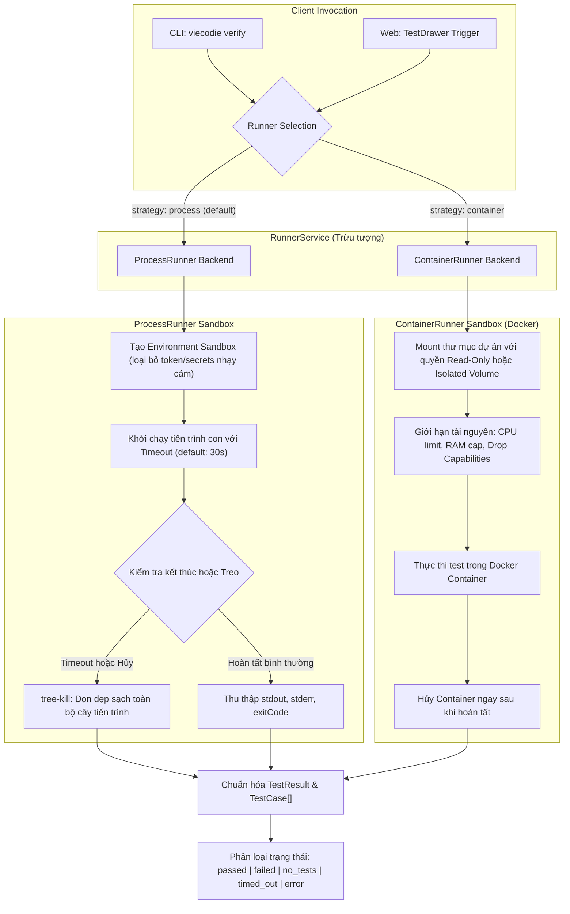

# KIẾN TRÚC KỸ THUẬT (ARCHITECTURE) — VIECODIE
**Dự án:** VIECODIE AI Code Reviewer by Graph  
**Phiên bản:** v3.13.1  
**Mục tiêu thiết kế:** Độc lập - Nhất quán - Minh bạch - Bảo vệ quyền riêng tư

---

## 1. Sơ đồ kiến trúc tổng thể (High-level Architecture)

VIECODIE được thiết kế theo mô hình **Một bộ máy lõi dùng chung (Unified Review Engine)**, phục vụ đồng thời cho 2 giao diện người dùng:
1. **Giao diện dòng lệnh (CLI):** Hoạt động độc lập, không phụ thuộc vào trình duyệt, có thể tích hợp CI/CD.
2. **Giao diện trực quan (Web - Code Reviewer by Graph):** Kết nối qua Localhost API/SSE để tương tác trên đồ thị gọi hàm.

```
       ┌───────────────────────────────┐          ┌──────────────────────────────────────┐
       │     CLI (Dòng lệnh độc lập)   │          │   Web (Code Reviewer by Graph)       │
       │   viecodie review / verify    │          │      React + Vite + SVG Canvas       │
       └──────────────┬────────────────┘          └──────────────────▲───────────────────┘
                      │                                              │ HTTP / SSE (Localhost)
                      ▼                                              ▼
       ┌─────────────────────────────────────────────────────────────────────────────────┐
       │                      UNIFIED REVIEW ENGINE (BỘ MÁY LÕI DÙNG CHUNG)              │
       │                                                                                 │
       │   1. File Scanner & AST Parser (TypeScript Compiler API)                        │
       │      ├─ Quét an toàn (tôn trọng .gitignore, bỏ binary, giới hạn kích thước)     │
       │      └─ Trích xuất hàm, biến, imports, và quan hệ gọi (Call Graph)              │
       │                                                                                 │
       │   2. Rule Engine (4 Nhóm quy tắc phân tích tĩnh)                                │
       │      ├─ Bảo mật (Security): SQL Injection, Hardcoded Secret, Eval/RCE           │
       │      ├─ Lỗi logic (Bug): So sánh lỏng lẻo ==, null/undefined unhandled          │
       │      ├─ Quy ước (Style): Khai báo var, đặt tên hàm, độ dài dòng               │
       │      └─ Bảo trì (Maintainability): Hàm quá dài, độ phức tạp cyclomatic          │
       │                                                                                 │
       │   3. AI Contextual Analyzer (DeepSeek R1/V3 / Ollama Local)                     │
       │      ├─ Thu hẹp ngữ cảnh dựa trên Call Graph (hàm + callers + callees)          │
       │      ├─ Schema validation nghiêm ngặt (tránh hallucination dòng code)          │
       │      └─ Cơ chế suy luận (Reasoning Content) & Fallback về Rule khi mất mạng     │
       │                                                                                 │
       │   4. Patch & Verification Engine                                                │
       │      ├─ Sinh mã vá lỗi định dạng Diff (Unified Diff)                            │
       │      └─ Bộ thực thi kiểm thử độc lập (Unified Runner Sandbox)                   │
       └─────────────────────────────────────────────────────────────────────────────────┘
```

---

## 2. Kiến trúc RunnerService (ProcessRunner & ContainerRunner)

Hệ thống phân tách lớp thực thi kiểm thử thông qua giao diện trừu tượng `RunnerService`, cho phép linh hoạt lựa chọn giữa môi trường tiến trình cục bộ có kiểm soát hoặc môi trường Docker container cô lập tuyệt đối.



---

## 3. Luồng bảo vệ đa tầng (Multi-layered Security Pipeline)

Mọi thao tác đọc mã nguồn, phân tích cú pháp, tương tác API và ghi bản vá đều đi qua 6 chốt chặn bảo mật nghiêm ngặt:

```mermaid
flowchart LR
    In["Mã nguồn Dự án"] --> S1["1. File Scanner Guard"]
    S1 -->|"Bỏ symlink ngoài root, tệp nhị phân, .env"| S2["2. Secret Scrubber"]
    S2 -->|"Che giấu token, API key (sk-..., AKIA...)"| S3["3. AST Parser & Rules Engine"]
    S3 -->|"Xây dựng Call Graph & 4 nhóm lỗi tĩnh"| S4["4. Server Session & Token Guard"]
    S4 -->|"Localhost only, CSRF token, không cấp cookie bừa bãi"| S5["5. Patch Verification & Safety"]
    S5 -->|"confineToRoot, bắt buộc confirm:true, chống patch rỗng"| S6["6. Unified Runner Sandbox"]
    S6 --> Out["Báo cáo kết quả & Mã nguồn an toàn"]
```



### Chi tiết các tầng bảo vệ:
1. **Tầng 1 - Scanner Guard:** Tuân thủ `.gitignore`, giới hạn kích thước tệp < 500KB, bỏ qua toàn bộ symbolic link trỏ ra ngoài project root nhằm ngăn chặn Symlink Loop và rò rỉ mã nguồn.
2. **Tầng 2 - Secret Scrubber (`scrubSecrets`):** Quét phát hiện và thay thế các chuỗi bí mật (OpenAI keys, AWS credentials, JWT tokens, private keys) bằng chuỗi đại diện `[REDACTED_SECRET]` trước khi dữ liệu được chuyển đến mô hình AI hoặc ghi log.
3. **Tầng 3 - AST Parser & Rules Engine:** Phân tích cú pháp dựa trên TypeScript Compiler API chính thống, trích xuất cấu trúc ngữ cảnh chính xác, không dùng regex phỏng đoán thiếu an toàn.
4. **Tầng 4 - Server Session Isolation:** Web server chỉ lắng nghe trên `127.0.0.1`, yêu cầu session token xác thực, ngăn chặn truy cập trái phép từ các tiến trình hoặc website khác trên máy người dùng.
5. **Tầng 5 - Patch Safety & Root Confinement:**
   - Hàm `confineToRoot` chuẩn hóa đường dẫn, chặn đứng tuyệt đối lỗ hổng Path Traversal (`../`) và Sibling Folder Injection.
   - Bắt buộc tham số `confirm: true` khi áp dụng bản vá; loại bỏ tình trạng biến câu gợi ý text thành code patch.
6. **Tầng 6 - Unified Runner Sandbox:** Thực thi kiểm chứng an toàn với timeout và `tree-kill`, không lưu trữ trạng thái nguy hiểm.

---

## 4. Luồng xử lý chi tiết (Pipeline)

### Bước 1: Quét tệp & Phân tích cú pháp (Scanner & AST Graph)
* Bộ quét duyệt qua cây thư mục dự án, tự động loại trừ `.git`, `node_modules`, `dist`, các tệp nhị phân và tệp vượt quá 500KB.
* Sử dụng TypeScript/JavaScript AST Parser để phân giải named imports, exports và xây dựng danh sách các Symbol/Hàm.
* Thiết lập đồ thị gọi (Call Graph): Node là các hàm, Edge là các quan hệ `calls`, `calls chéo tệp (cross-file)` và `HTTP suy đoán`.

### Bước 2: Phân tích 4 nhóm vấn đề & AI làm giàu ngữ cảnh
* **Quy tắc tĩnh (AST Rules):** Quét phát hiện ngay lập tức các mẫu lỗi xác định (SQL string concat, hardcoded token, so sánh `==`, v.v.).
* **AI Contextual Analysis:** Với các điểm nghi vấn, hệ thống gom đoạn mã của hàm mục tiêu cùng các hàm gọi nó (callers) gửi tới mô hình AI (DeepSeek hoặc Ollama).
* AI phân tích nguyên nhân gốc rễ, điều kiện kích hoạt lỗi và đề xuất bản sửa cụ thể.

### Bước 3: Đóng gói Báo cáo (Unified Report)
* Mỗi phát hiện (Finding) có cấu trúc chuẩn xác:
  * Mã định danh, tệp, số dòng bắt đầu/kết thúc.
  * Mức độ nghiêm trọng (`critical`, `high`, `medium`, `low`).
  * Nhóm vấn đề (`security`, `bug`, `style`, `maintainability`).
  * Bằng chứng trong code (`evidence`), nguyên nhân, điều kiện kích hoạt.
  * Bản vá đề xuất (`patch`) với diff rõ ràng.

### Bước 4: Kiểm chứng (Verification)
* Người dùng xem trước diff trước khi đồng ý áp dụng (`Apply Patch`).
* Sau khi áp dụng bản sửa, bộ kiểm thử (`verify`) chạy lại các test suites trong môi trường sandbox để xác nhận lỗi đã được khắc phục hoàn toàn mà không làm gãy các chức năng cũ.

---

## 5. Ranh giới tin cậy & Bảo mật dữ liệu (Trust Boundary)
1. **Chỉ đọc theo mặc định (Read-only by default):** Quá trình phân tích mã không bao giờ tự ý thay đổi file hoặc ghi đè mã nguồn.
2. **Minh bạch luồng dữ liệu:**
   * Khi dùng **Ollama (Offline)**: Mã nguồn không bao giờ rời khỏi máy tính cá nhân.
   * Khi dùng **DeepSeek (Online API)**: Chỉ các đoạn mã của các hàm trong phạm vi phân tích kèm prompt được gửi qua kết nối HTTPS mã hóa tới server DeepSeek; tuyệt đối không gửi các tệp `.env`, khóa SSH, credential cá nhân.
3. **Phê duyệt của người dùng (Human-in-the-loop):** Mọi thao tác sửa code (`Apply Patch`) đều yêu cầu xác nhận rõ ràng từ lập trình viên.
